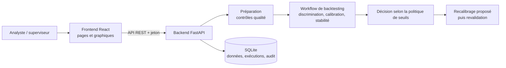

# Backtesting et recalibrage des modèles de notation interne

Application web réalisée pendant mon stage à l'UBCI (2026). Elle automatise le backtesting annuel des modèles de notation interne (PD) :
- préparation des données ;
- mesure de la discrimination, de la calibration et de la stabilité ;
- décision motivée ;
- proposition de recalibrage, puis revalidation.

Aucune donnée de la banque n'est publiée. Les captures ont été réalisées sur des **données simulées**, et le nom de la banque est retiré de l'interface.


## Architecture



| Couche | Fichiers | Rôle |
|---|---|---|
| API | `backend/app/main.py`, `schemas.py`, `auth.py` | Points d'accès REST, validation des entrées, rôles (analyste, superviseur, administrateur) |
| Calculs | `backend/app/services/` | `preparation` (qualité et définition du défaut), `metrics` (AUC, Gini, KS, Brier, tests binomial et de Vasicek, PSI), `workflow` et `backtesting` (enchaînement et verdict), `governance` (seuils), `recalibration`, `simulation` (données fictives par copule gaussienne), `assistant` (explications) |
| Stockage | `backend/app/storage.py` | SQLite : jeux de données, une partition par modèle, exécutions, journal d'audit |
| Interface | `frontend/src/` | Pages Données, Backtesting et Tableau de bord, assistant, client API |
| Tests | `backend/tests/` | Indicateurs, workflow et assistant (`pytest`) |

## Comment l'application a été construite

1. **Cadrage avec l'équipe Risques.** Je suis partie de la procédure de backtesting annuel existante, faite dans Excel, et de la liste des indicateurs attendus pour chacun des trois modèles : Professionnel, Corporate/TPME avec états financiers, Corporate/TPME sans états financiers.
2. **Moteur de calcul en Python.** Les indicateurs ont été codés et testés un par un dans `services/metrics.py`, puis comparés aux résultats du fichier Excel de référence.
3. **Règles de décision séparées du code.** Les seuils (Gini minimal, feux tricolores, PSI) sont regroupés dans une politique versionnée (`services/governance.py`). Chaque verdict cite la règle appliquée.
4. **API FastAPI.** Elle gère l'import, les contrôles et les exécutions. Toutes les actions sont historisées, et une proposition de recalibrage n'est jamais appliquée sans l'approbation d'un superviseur.
5. **Interface React.** La maquette a été conçue dans Figma, puis développée en React avec TypeScript, Tailwind et Recharts.
6. **Validation.** Des tests automatisés couvrent les calculs. Une simulation sur données fictives a permis de tester l'enchaînement complet sans utiliser de données réelles.

## Méthodes

| Étape | Méthode | Pourquoi |
|---|---|---|
| Discrimination | AUC, Gini, KS, avec intervalle de confiance par bootstrap | Le Gini est le standard bancaire ; le KS montre où se fait la séparation |
| Calibration | Test de Vasicek par classe (feux tricolores), Hosmer-Lemeshow global, intervalles de Wilson | Le test de Vasicek tient compte de la corrélation des défauts entre emprunteurs |
| Stabilité | PSI, puis matrices de migration | Le PSI alerte ; les migrations expliquent le déplacement |
| Recalibrage | Logistique si les défauts sont suffisants, bayésien sinon ; PD contraintes à la monotonie | Les portefeuilles corporate comptent peu de défauts |

D'autres écrans sont montrés dans les captures [recalibrage](captures/recalibrage.png) et [rapports](captures/rapports.png).

## Lancer l'application

```bash
# Backend
cd backend
pip install -r requirements.txt
export BACKTESTING_SECRET="une-cle-longue-et-aleatoire"   # PowerShell : $env:BACKTESTING_SECRET="..."
uvicorn app.main:app --reload        # API sur http://127.0.0.1:8000/docs
pytest                               # tests

# Frontend
cd frontend
npm install
npm run dev                          # http://localhost:8443
```

L'application attend un export Excel du portefeuille noté. Les colonnes obligatoires sont `Number`, `Counterparty`, `Created Date`, `Model Scoring Name`, `Final Rating Class` et `Final Pd Class`. Aucun jeu de données n'est fourni.

Technologies : Python (FastAPI, pandas, NumPy), React, TypeScript, Vite, Tailwind, Recharts, SQLite, pytest.
