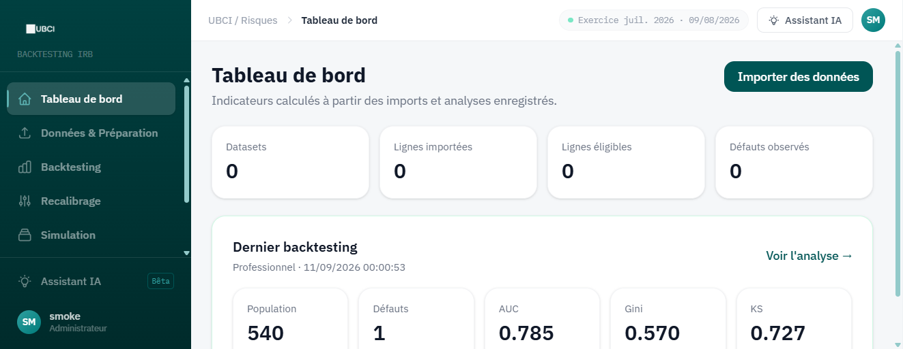
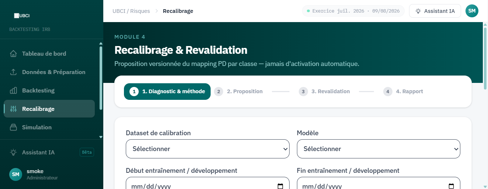
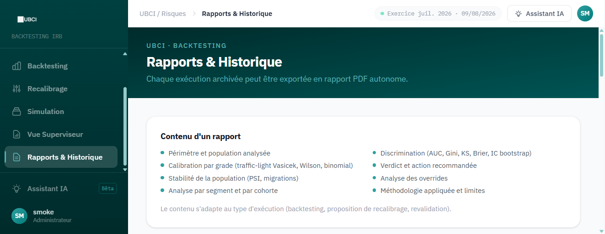

# Backtesting et recalibrage des modèles de notation interne

Application web réalisée pendant mon stage à l'UBCI (2026). Elle automatise le backtesting annuel des modèles de notation interne (PD) : préparation des données, mesure de la discrimination et de la calibration, décision motivée, puis proposition de recalibrage avec revalidation.

Ce dépôt présente un extrait du code et des captures de l'application. Les captures ont été réalisées sur des **données simulées** : aucune donnée de la banque n'est publiée ici.

## Captures

**Tableau de bord** : indicateurs du dernier backtesting (population, défauts, AUC, Gini, KS).

**Recalibrage et revalidation** : proposition de PD par classe en 4 étapes, jamais activée automatiquement.

**Rapports** : chaque analyse peut être exportée en rapport PDF.

## Ce que fait l'application

1. **Import et préparation** : fichiers Excel, CSV ou texte, correspondance automatique des colonnes, contrôles de qualité, définition du défaut et exclusions motivées.
2. **Discrimination** : AUC, Gini, KS et Brier, avec intervalles de confiance par bootstrap.
3. **Calibration par note** : tests binomial et de Vasicek, intervalles de Wilson, présentés en feux tricolores.
4. **Stabilité** : indice PSI et matrices de migration.
5. **Décision** : verdict motivé selon une politique de seuils centralisée.
6. **Recalibrage** : proposition de nouvelles PD par classe, revalidation puis approbation.

## Code présenté

| Fichier | Rôle |
|---|---|
| `code/metrics.py` | Indicateurs de discrimination et de calibration |
| `code/backtesting.py` | Moteur de backtesting et décision finale |
| `code/recalibration.py` | Propositions de PD par classe |
| `code/preparation.py` | Contrôles de qualité et définition du défaut |
| `code/governance.py` | Politique de seuils |

Technologies : Python (FastAPI), React, Vite, Tailwind, pytest.
